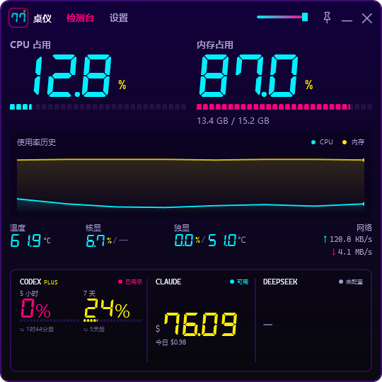

# 桌仪 · LocalDeck 1.5.5

一个 Windows 11 桌面迷你仪表：CPU、内存、温度、NVIDIA GPU、网络，以及 Codex 额度、DeepSeek 余额，全部放进一块 **360 × 360** 的迷你方形 LCD。

> **GitHub 源码**：https://github.com/coffaye/local-deck  
> **下载最新版**：https://github.com/coffaye/local-deck/releases/latest


> 截图使用界面演示数据；实际运行时所有硬件与额度均从本机读取。

实机状态（本机、未配置 DeepSeek Key）：



## 1.5.5 额度数字回调到平衡位置

- 5 小时 / 7 天标签保持在数值上方。
- 0% / 100% 大数字的纵向偏移从 30 回收到 23，处于「偏高」与「偏低」之间，和右侧 DeepSeek 余额更自然地对齐。
- 设置页固定底部保存栏和主题选择继续保持。

## 1.5.1 主题细节与设置页修复

- 额度优先主题下，Codex 的「5 小时 / 7 天」标签从 6px 放大到 9px 半粗体，和放大的额度数字更匹配。
- 设置页把「保存并应用」移到固定底部栏，上面的三组设置放进可滚动区域；按钮不会再被切掉。常规尺寸下内容仍能一屏放下，不出现滚动条。
- 性能优先主题及其余界面保持原样。

## 1.5.0 双主题：性能优先 / 额度优先

- **主题 1「性能优先」= 当前原样**：CPU / 内存大数字在上，历史曲线居中，额度条在底部；不改变任何现有布局。
- **主题 2「额度优先」= 只改 UI**：
  - 额度条移到顶部，并放大 Codex / DeepSeek 数字；
  - CPU / 内存数字缩小、行高压缩；
  - 历史曲线缩短后移到中下部；
  - 温度 / 核显 / 独显 / 网络保持在最底部。
  - 数据刷新、托盘、字体主题、设置项行为均不变。
- 设置 → 窗口卡片右侧新增「主题」下拉框：`性能优先` / `额度优先`；点「保存并应用」立即切换并持久化，下次启动保持。


## 1.4.4 托盘菜单与密钥位置修复

- **修复托盘右键菜单的白色块**：改为 Windows 原生 `TrackPopupMenuEx` 菜单，不再使用 WPF `ContextMenu` 的图标/勾选槽，因此没有那块白色空白。
- **修复菜单不消失**：原生菜单由 Windows 自己管理弹出/关闭，点击菜单外任意位置会立即关闭。
- **托盘悬停文字**：只显示「桌仪」，不再附加「左键打开，右键退出」。
- **修复更新后 DeepSeek key 消失**：根因是 1.4.3 以 Medium 权限启动后，设置路径从 `dist\LocalDeck-data` 切到了可写的 `%APPDATA%\LocalDeck`，而新位置没有密钥；旧密钥仍完好保存在 `dist\LocalDeck-data`。现在：
  - 已存在的便携 `LocalDeck-data` 优先于 Roaming，设置路径不再随进程权限变化。
  - 已把原 DPAPI 密文同步回 `%APPDATA%\LocalDeck`，两种路径下都能恢复密钥。
  - 密钥仍为 DPAPI 加密，没有明文落盘。
- 保留 1.4.3 的启动提速（窗口约 1.1 秒）、Medium 完整性分发、启动脚本和托盘常显。

## 1.4.3 启动提速、托盘与 SmartScreen

- **启动慢的原因已修复**：`SystemSampler` 过去在窗口构造之前就同步初始化 NVML 和 LibreHardwareMonitor；LHM 的 `Computer.Open()` 会在启动时扫描硬件，实测让窗口出现耗时约 **6.6 秒**。现在把这些初始化移到后台线程，并在就绪后逐个接入；窗口出现实测降到约 **0.8 秒**，CPU / 内存先显示，核显传感器稍后补齐。
- **托盘/权限**：构建产物会重新标记为 Medium 完整性，并提供 `启动桌仪.cmd`。低权限沙箱（例如直接从代理界面点开 exe）会被 Windows 禁止创建托盘图标，这时会退化为最小化；请从资源管理器运行 `启动桌仪.cmd`。
- **托盘图标与电池/时间同区**：仍是原生 `Shell_NotifyIcon`；Windows 11 默认把新图标放入 `^`。程序会尝试把本应用图标标记为常显；若系统仍未立即刷新，点开 `^` 把 77 图标拖到电池/时间旁一次即可。
- **右键退出**：托盘图标右键菜单为「打开 / 退出」；选「退出」会真正结束进程，不会留在后台。若走了最小化兜底，任务栏右键关闭也会退出。
- **SmartScreen「仍要运行」**：这是未签名程序的 Windows 信任提示，不是界面逻辑。推荐用 `启动桌仪.cmd`，它会先 `Unblock-File` 并以 Medium 完整性启动；程序运行后也会自清理自身 Mark-of-the-Web，后续直接启动不再反复提示。要从所有机器上彻底取消，只能做代码签名证书，当前没有证书。

## 1.4.2 标题栏边框与托盘

- **隐藏标题栏时整块窗框一起下移**：不再只隐藏标题栏文字并留下 30px 空白。标题栏隐藏时窗口顶部下移 30px、窗口高度同步缩短 30px；正文高度保持 330px，所以内容在屏幕上的位置完全不变。重新聚焦时窗框上沿再上移，标题栏恢复。检测台和设置页都不会跳。
- **托盘图标改为原生 Shell_NotifyIcon**：点击 X 后窗口隐藏，系统托盘保留 77 图标；左键打开，右键菜单提供「打开 / 退出」。
- **Windows 11 托盘限制**：Windows 11 默认把新托盘图标放进任务栏的 `^` 隐藏图标区，应用无法强制把它钉在任务栏。首次隐藏会弹出提示；点开 `^`，把 77 图标拖到任务栏即可固定。
- **兜底可见**：如果系统安全策略拒绝托盘注册，点击 X 会最小化到任务栏（保留任务栏按钮），不会让程序消失；此时可通过任务栏右键关闭退出。

## 1.4.1 背景透明度与设置重排

- **透明度改为真正的背景透明**：不再设置整个窗口的 `Window.Opacity`，而是让窗口透明，只调整背景层 `Backdrop` 的 alpha。文字、数字、图标和控件始终保持 100% 不透明，透出的是桌面/壁纸，不会把整块 UI 一起变暗。
- **滑条位置与形状**：移到顶部图钉左侧，52px 短横条；滑块改为最简的 5 × 10 小长方条。范围 35%–100%，仍会随设置保存。
- **设置页重排**：从居中的长表单改为铺满方形页面的「数据源 / 刷新 / 窗口」三组卡片；保存按钮回到可见的底部区域，不再出现大面积留白或保存按钮被裁切。
- **标题栏隐藏不再位移**：勾选并保存后，失焦时只把顶部标题栏隐藏，但保留 30px 占位；检测台和设置页的内容位置都不再上下跳。
- 保留 1.4.0 的 **360 × 360 1:1 方形**、X 隐藏到系统托盘（左键打开 / 右键退出）、独显 `℃` 单位与底部字符留白修复。

## 1.4.0 方形与托盘

- 整体改为 1:1 方形：窗口固定 360 × 360，原有布局顺序不变。
- X 不再退出：点击右上角 X 只隐藏到右下角系统托盘；左键托盘图标重新打开，右键菜单提供「打开」和「退出」。
- 独显温度单位改为 `℃`。
- 本版后续在 1.4.1 中修正了滑条只改变背景 alpha、滑条位置、设置页布局与标题栏隐藏位移问题。

## 1.3.0 双 GPU

- **移除「额度」标签页**：顶部只保留「检测台」「设置」；额度摘要仍在检测台底部，不再单独占一页。
- **双 GPU 分开展示**：在核显和网络之间增加「独显」读数；「核显」显示核显负载，「独显」显示独显负载 / 温度。
- **GPU 温度单位**：1.3.0 曾用 `°`，1.4.0 起独显改为 `℃`；CPU 温度仍使用 `°C`。
- 核显负载来自 LibreHardwareMonitor 的 D3D 3D 传感器；独显数据继续来自 NVIDIA NVML。
- **核显温度**：Radeon 780M 驱动没有暴露独立温度传感器，界面显示 `—`，不伪造温度；独显温度正常显示。
- 增加 LibreHardwareMonitorLib 依赖与 MPL-2.0 说明。

## 1.2.1 修复

- **DeepSeek 密钥不再被维护清空**：构建脚本现在会在清理 `dist` 前备份、构建后恢复 `LocalDeck-data`；便携版的数据也不会进入 zip。之前已被清掉的密钥无法恢复，请重新填写一次。
- **输入框留空不是清除**：密钥保存后，出于安全不会回显；设置页会显示「密钥已保存 · 留空不修改」。留空直接保存会保留原密钥，只有点「清除」再保存才会删除。
- **去掉三个页面的页头标题**：不再显示「检测台 / 额度 / 设置」，内容从顶栏下方直接开始；顶栏标签仍表示当前页面。
- **设置页「保存并应用」不再缺下半部分**：移除页头后正文高度增加，按钮完整显示。
- **Windows 旧图标**：exe 与窗口图标已确认是新的霓虹 77；Windows 资源管理器/任务栏可能缓存旧图标。可运行 `刷新Windows图标.cmd`；任务栏固定项请先取消固定，再从新 exe 重新固定。

## 1.2.0 迷你版

- 窗口固定为 **360 × 220**，约为上一版宽高的三分之一；不再支持拖拽缩放，但可拖动窗口。
- **CPU / 内存分段格对齐到同一行**；内存已用容量移到格子下方，不再把两条格子错开。
- 额度区域改为紧凑条带：Codex 5h / 7d、重置次数、DeepSeek 余额连续排布，`2 次重置可用` 下方不再留大块空白。
- 去掉页头右侧的圆点 + 渐变线。
- **设置增加「硬件刷新」**：1 / 2 / 5 / 10 秒，控制 CPU、GPU、温度、网络采样；保存后立即重启采样循环。
- 顶部三个标签改为纯文字、无外框；置顶 / 最小化 / 关闭改为无外框线框图标。
- Logo 改为霓虹色 **77**，去掉数字下方的 5 条短线；任务栏与左上角共用同一图标。

## 1.0.1 启动修复

- **修复“点击仍要运行后没有窗口”**：上一版是 63 MB 自包含单文件，启动前必须解压到 `%TEMP%\.net\LocalDeck`；部分 Windows 安全环境会拒绝这次解压，程序在显示窗口前就静默退出。现在主程序改为不需要临时解压的框架单文件；另外附完整自包含文件夹。**请不要再用旧版 63 MB 的 LocalDeck.exe。**
- **单实例**：重复双击只会切回已有窗口，不会重复产生后台进程。
- **启动错误日志**：启动失败或界面异常时，不再完全无提示，会显示错误框或写入 `LocalDeck-error.log`。
- **“后台进程”误解**：任务管理器中的“后台进程”只是无可见窗口的进程分组，不是待处理队列；桌仪关闭窗口即退出，无常驻服务。

## 直接运行

```text
dist\LocalDeck.exe                         ← 主程序，建议使用（单文件，约 2.3 MB）
dist\LocalDeck-portable\LocalDeck.exe      ← 自包含版（整个文件夹必须保留）
dist\LocalDeck-portable.zip                ← 自包含版的压缩包
```

**主程序**：

- 双击 `LocalDeck.exe`。
- 需要系统已安装 **.NET 8 Desktop Runtime**；本机已经安装。
- 不再解压到 Temp，因此不会再出现“点击 Run anyway 后无反应”。
- 未做商业代码签名，首次运行仍可能出现 SmartScreen；选择「更多信息 → 仍要运行」即可。

**如果主程序提示缺少 .NET，或想拷到其他电脑**：

- 解压 `LocalDeck-portable.zip`（或直接进入 `LocalDeck-portable` 文件夹）。
- 双击其中的 `LocalDeck.exe`。
- **不能只复制这一个 exe**，同目录的 DLL 必须一起保留。自包含版不依赖 .NET，也不解压 Temp。

其他：

- 不需要管理员权限。
- 设置保存在 `%APPDATA%\LocalDeck\settings.json`。如果该目录不可写，会自动回退到 exe 同目录的 `LocalDeck-data\settings.json`；使用 exe 同目录回退时，`build.ps1` 会在重建前备份、重建后恢复这个目录，不会再用维护清空密钥。
- 设置文件里的 DeepSeek 密钥使用 Windows DPAPI 加密，不会以明文写入磁盘。
- 如果启动后仍然没有窗口，查看同目录的 `LocalDeck-error.log`。

### 关于任务管理器里的“后台进程”

Windows 任务管理器会把没有可见窗口的进程放进“后台进程”分组，例如 `svchost.exe`、浏览器辅助进程、输入法、WebView2 等。这是正常的进程分组，**不是待处理任务**。

桌仪本身只有一个可见的 `LocalDeck` 进程；关闭窗口就退出，没有常驻后台服务。重复启动会切回已有窗口，不会叠加后台进程。Codex 额度刷新时会短暂启动一次 `codex.exe`，查询结束后自动结束。

## 功能

### 本机监测

- **CPU 占用**：`GetSystemTimes` 采样，DSEG7 数字、分段网格和简化历史曲线。
- **内存占用**：`GlobalMemoryStatusEx`，显示百分比与已用 / 总容量。
- **CPU 温度**：Windows ACPI 热区的 PDH 性能计数器，显示近似温度。
- **核显**：LibreHardwareMonitor 的 D3D 3D 负载；AMD Radeon 780M 等核显温度通常不可用，显示 `—`。
- **独显**：NVIDIA NVML，读取利用率与温度，温度单位只用 `°`；支持 RTX 4060 Laptop 等 NVIDIA 显卡。
- **网络**：所选网卡的 IPv4/IPv6 收发字节差，显示上下行速率。
- **采样周期**：在「设置 → 硬件刷新」选择 1 / 2 / 5 / 10 秒；保存后立即生效。

### Codex 额度

展示 5 小时 / 7 天剩余额度、重置时间、可用重置次数与计划类型，集中在检测台底部的额度条。

读取链路（只读，不会消费额度、不会执行重置）：

1. **`codex app-server`**：本机 Codex CLI 的官方只读 JSON-RPC 接口；
2. **本机 HTTP 登录态**：读取 `~/.codex/auth.json` 中的现有 access token，请求 Codex 使用情况接口；
3. **本地快照**：读取最近的 Codex rollout JSONL 中的 `rate_limits` 记录，并标记为缓存。

程序不会刷新或写入 Codex token，也不会把 token 写入日志或发送给第三方。自动检测不到 Codex CLI 时，可在「设置」里手动选择 `codex.exe`。

### DeepSeek 余额

通过官方 `GET https://api.deepseek.com/user/balance` 读取账户余额（CNY 或 USD），显示余额与可用状态。

在「设置 → DeepSeek 密钥」中填入 API Key，点「测试」可以不出保存先验证，再「保存并应用」。也支持环境变量 `DEEPSEEK_API_KEY` 自动读取。

## 设置

设置页在 360 × 360 方形内以居中的紧凑表单呈现：

- **Codex 路径**：自动检测，也可以手动浏览。
- **DeepSeek 密钥**：本机 DPAPI 加密保存。
- **统计网卡**：默认自动选择有网关的活动网卡。
- **额度刷新**：1 / 5 / 15 / 30 分钟。
- **硬件刷新**：1 / 2 / 5 / 10 秒（CPU、GPU、温度、网络）。
- **窗口置顶**、**开机启动**。

## 构建

要求：Windows x64、.NET 8 SDK。

```powershell
pwsh .\build.ps1
```

脚本会生成：

- `dist\LocalDeck.exe`：框架单文件，不依赖 Temp 解压，需要 .NET 8 Desktop Runtime；
- `dist\LocalDeck-portable\`：自包含文件夹，不依赖 .NET，需要保留全部文件；
- `dist\LocalDeck-portable.zip`：上述文件夹的压缩包；
- `dist\README.md`、`dist\快速开始.txt`、`dist\screenshots\`、字体许可证。

验证：

```powershell
# 无窗口自检，结果写入当前目录 LocalDeck-selftest.txt
.\dist\LocalDeck.exe --selftest

# 使用演示数据渲染页面截图
.\dist\LocalDeck.exe --demo --capture .\screenshots\demo
```

开发预览：`--demo` 使用固定演示数据；默认启动始终读取真实数据。

## 已知边界

- 主程序需要 .NET 8 Desktop Runtime；自包含文件夹不需要。两者都不需要管理员权限。
- 窗口固定为 360 × 360（1:1），不提供缩放；需要移动时可拖动顶部空白处。
- 点击 X 只会隐藏到系统托盘；退出请右键托盘图标选「退出」。Windows 11 新图标默认在 `^` 隐藏区；系统拒绝托盘注册时会最小化到任务栏。
- 右侧透明度滑条调整的是整个窗口透明度。
- SmartScreen 提示是因为主程序和文件夹版都没有商业代码签名；按「更多信息 → 仍要运行」即可。若文件有“来自其他计算机”的锁定，可在右键属性里勾选“解除锁定”。
- CPU 温度来自 ACPI 热区，适合看趋势，不等同于 HWiNFO 的 CPU package 温度；不同主板可能没有该计数器，此时显示 `—`。
- GPU 只接入 NVIDIA NVML，AMD / Intel 核显目前不显示。
- Codex 额度按当前 ChatGPT 登录方式读取；若使用 API Key 模式，可能只能回退到本地快照。HTTP 回退使用的是本机 Codex 登录态，不是公开文档接口；接口变化时会继续回退到本地快照。
- DeepSeek 余额需要用户自己的 API Key，程序不内置任何账户凭据。

## 目录

```text
LocalDeck.csproj          WPF / .NET 8 项目
MainWindow.xaml(.cs)      360 × 360 方形界面与窗口流程
Services/                 硬件、Codex、DeepSeek、设置服务
Controls/                 DSEG 数字、分段进度条、历史曲线
ViewModels/               页面状态
assets/                   嵌入字体与 77 霓虹图标
快速开始.txt              分发版启动说明
刷新Windows图标.cmd       Windows 图标缓存刷新
托盘                      X 隐藏到右下角；左键打开，右键退出
LibreHardwareMonitor...   LHM 依赖许可说明
docs/DESIGN.md            设计说明
screenshots/              界面证据
```

## 第三方

- **DSEG7 Classic** 字体，作者 keshikan，SIL Open Font License 1.1。字体文件位于 `assets/`，许可证见 `assets/DSEG-LICENSE.txt`。
- **LibreHardwareMonitorLib 0.9.4**，MPL-2.0；用于只读核显负载传感器。说明见 `LibreHardwareMonitor-NOTICE.txt`。
- Codex 读取接口与 DeepSeek 余额接口的使用受各自服务条款约束；本项目只做本机个人仪表展示。


