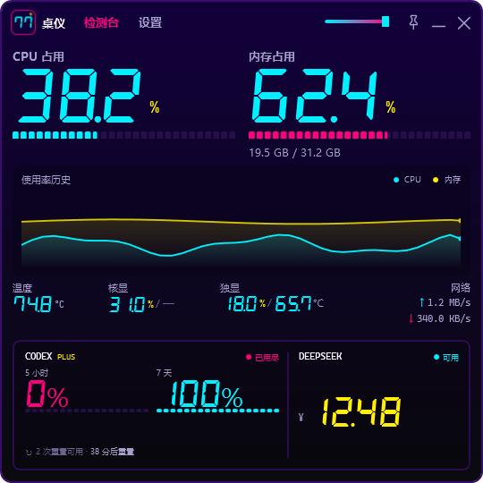
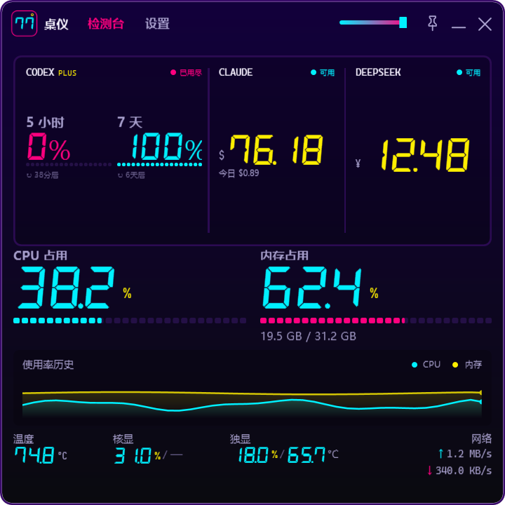

# 桌仪 · LocalDeck 1.5.5

一个 Windows 11 桌面迷你仪表：CPU、内存、温度、NVIDIA GPU、网络，以及 Codex 额度、DeepSeek 余额，全部放进一块 **360 × 360** 的方形 LCD。

> **GitHub 源码**：https://github.com/coffaye/local-deck  
> **下载最新版**：https://github.com/coffaye/local-deck/releases/latest



> 截图使用演示数据；实际运行时硬件与额度均从本机读取。



## 当前版本

- **双主题**：设置 → 窗口右侧选择「性能优先 / 额度优先」，保存后立即切换并持久化。
  - **性能优先**：CPU / 内存大数字在上，历史曲线居中，额度条在底部。
  - **额度优先**：额度条置顶并放大 Codex / DeepSeek 数字；5 小时 / 7 天标签在数值上方，0% / 100% 与 DeepSeek 余额对齐；CPU / 内存缩小，曲线下移，传感器行留底部。
- **360 × 360 固定方形窗口**，布局紧凑，不支持拖拽缩放。
- **背景透明度滑条**：位于顶部图钉左侧，只调整背景 alpha，文字、数字和控件保持不透明。
- **标题栏隐藏**：失焦时整块窗框上沿下移、窗口高度缩短，正文位置不变；重新聚焦恢复。
- **系统托盘**：点 X 隐藏到通知区（电池 / 时间所在区域）；左键打开，右键菜单提供「打开 / 退出」。Windows 11 新图标可能在 `^` 里，展开后拖出一次即可固定。
- **启动优化**：硬件传感器在后台初始化，窗口约 1 秒出现，CPU / 内存先显示，核显数据随后补齐。
- **设置页**：三组卡片；主题、刷新间隔、窗口开关和密钥设置；保存按钮固定在底部，不会被裁切。

## 下载与运行

Release 资产：

- `LocalDeck.exe`：单文件，需要 **.NET 8 Desktop Runtime**（约 2.3 MB）。
- `LocalDeck-portable.zip`：自包含文件夹，不需要安装 .NET（约 68 MB）。
- `start-localdeck.cmd`：推荐启动入口；对应压缩包里的 `启动桌仪.cmd`。
- `SHA256SUMS.txt`：三个文件的 SHA256。

**推荐**：从 [Releases](https://github.com/coffaye/local-deck/releases/latest) 下载 exe 和 `start-localdeck.cmd` 放在同一目录，双击启动脚本。它会先解除下载阻止、设置普通权限，再启动程序。

直接启动 `LocalDeck.exe` 也可以；程序未做商业代码签名，首次可能看到 SmartScreen「仍要运行」，点「更多信息 → 仍要运行」即可。启动脚本和程序自身都会尽量移除后续的下载阻止。

自包含版必须保留整个文件夹，不能只复制单个 exe。两种版本都不需要管理员权限，也不会解压到 `%TEMP%`。

**关闭 / 退出**：点 X 只隐藏到托盘，不是退出。左键托盘图标恢复；右键托盘图标选「退出」才真正结束进程。如果系统策略拒绝托盘注册，程序会退化为最小化到任务栏，而不是消失；此时可用任务栏右键关闭退出。

**设置与密钥**：如果 exe 同目录已有 `LocalDeck-data\settings.json`，程序优先使用它；否则使用 `%APPDATA%\LocalDeck\settings.json`。DeepSeek Key 使用 Windows DPAPI 加密，不会明文落盘，也不会进入仓库或 Release 资产。

## 界面与数据

### 检测台

- **CPU**：`GetSystemTimes` 采样，DSEG7 数字、分段网格和历史曲线。
- **内存**：`GlobalMemoryStatusEx`，显示百分比和已用 / 总容量。
- **CPU 温度**：ACPI 热区的 PDH 计数器，适合看趋势，不等同于 HWiNFO 的 CPU package 温度。
- **核显**：LibreHardwareMonitor 的 D3D 3D 负载；Radeon 780M 等核显通常没有独立温度传感器，温度显示 `—`。
- **独显**：NVIDIA NVML，读取利用率和温度，温度单位使用 `℃`。
- **网络**：所选网卡的收发字节差，显示上下行速率。
- **刷新**：硬件刷新可在 1 / 2 / 5 / 10 秒间切换。

### Codex 额度

展示 5 小时 / 7 天剩余额度、重置时间、可用重置次数和计划类型。读取链路只读，不消费额度、不执行重置：

1. 本机 `codex app-server` 的只读 JSON-RPC；
2. 本机 Codex 登录态；
3. 最近的本地 rollout 快照。

不会刷新或写入 Codex token，也不会把 token 写入日志或发送给第三方。

### DeepSeek 余额

通过官方 `GET https://api.deepseek.com/user/balance` 读取余额（CNY / USD）和可用状态。可在设置中填写 API Key 并测试；也支持环境变量 `DEEPSEEK_API_KEY`。

## 设置

设置页为三组卡片：

- **数据源**：Codex 路径自动检测 / 浏览；DeepSeek 密钥测试 / 清除。
- **刷新**：统计网卡、额度刷新（1 / 5 / 15 / 30 分钟）、硬件刷新。
- **窗口**：主题、窗口置顶、开机启动、标题栏隐藏。
- 底部固定「保存并应用」；保存后主题、刷新间隔和开关立即生效。

顶部图钉左侧的短滑条单独控制背景透明度。

## 构建

要求 Windows x64、.NET 8 SDK：

```powershell
pwsh .\build.ps1
```

输出：

- `dist\LocalDeck.exe`：框架单文件，不需要 Temp 解压，需要 .NET 8 Desktop Runtime；
- `dist\LocalDeck-portable\`：自包含文件夹；
- `dist\LocalDeck-portable.zip`；
- `dist\README.md`、`快速开始.txt`、截图、字体许可证和 LHM 说明。

验证：

```powershell
.\dist\LocalDeck.exe --selftest

# 使用演示数据渲染截图
.\dist\LocalDeck.exe --demo --capture .\screenshots\demo
```

## 已知边界

- 主程序需要 .NET 8 Desktop Runtime；自包含版不需要。两者都不需要管理员权限。
- 窗口固定为 360 × 360，不提供缩放；可拖动顶部空白处移动。
- 核显只读取负载，没有可靠的独立温度；独显温度来自 NVML。
- CPU 温度来自 ACPI，部分主板可能没有该计数器，此时显示 `—`。
- Codex 额度依赖本机登录态；接口不可用时会回退到本地快照。
- Windows 11 的托盘图标默认可能进入 `^`；应用会尝试设为常显，未生效时拖出一次即可。
- 未做代码签名，首次直接运行可能出现 SmartScreen；推荐使用启动脚本。
- DeepSeek 余额需要自己的 API Key；仓库不内置任何账户凭据。

## 目录

```text
LocalDeck.csproj          WPF / .NET 8 项目
MainWindow.xaml(.cs)      360 × 360 方形界面与窗口流程
Services/                 硬件、Codex、DeepSeek、设置服务
Controls/                 DSEG 数字、分段进度条、历史曲线
ViewModels/               页面状态
assets/                   嵌入字体与 77 霓虹图标
启动桌仪.cmd              分发版推荐启动入口
刷新Windows图标.cmd       Windows 图标缓存刷新
快速开始.txt              分发版启动说明
docs/DESIGN.md            设计说明
screenshots/              界面证据
```

## 第三方

- **DSEG7 Classic**，作者 keshikan，SIL Open Font License 1.1；文件位于 `assets/`，许可证见 `assets/DSEG-LICENSE.txt`。
- **LibreHardwareMonitorLib 0.9.4**，MPL-2.0；用于只读核显负载，说明见 `assets/LibreHardwareMonitor-NOTICE.txt`。
- Codex 与 DeepSeek 接口的使用受各自服务条款约束；本项目只做本机个人仪表展示。
